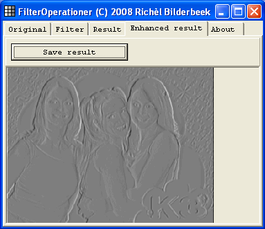

# FilterOperationer (VCL)

Performs filter operations on images.

FilterOperationer (VCL) is one of [Richèl Bilderbeek's tools](https://richelbilderbeek.github.io/tools/).

## Links

- [Source code](https://github.com/richelbilderbeek/FilterOperationerVcl)
- [Richèl Bilderbeek's tools](https://richelbilderbeek.github.io/tools/)
